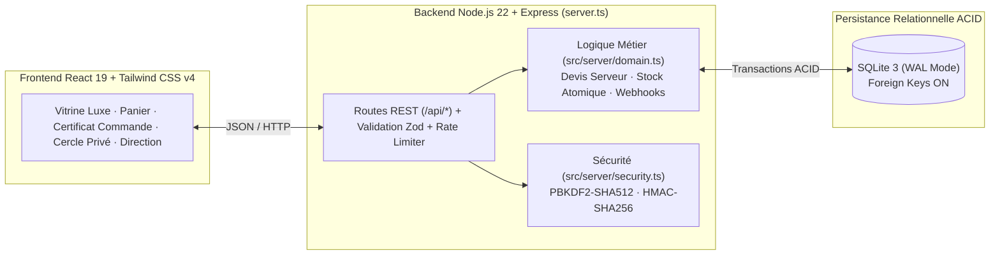

# Maison Véra — Haute Facture Architecturale (E-Commerce Afrique & International)

[](./ci.workflow.yml)
[](./.nvmrc)
[](./tsconfig.json)
[](./LICENSE)

**Maison Véra** est une plateforme e-commerce full-stack complète de haute facture architecturale, pensée et optimisée de bout en bout pour le **marché africain (zones CEMAC & UEMOA)** et **international**.

L'application allie une **interface client éditoriale, épurée et luxueuse** (sans aucun jargon technique exposé au visiteur) à un **moteur transactionnel de niveau production** : recalcul serveur intégral des prix, réservation atomique des stocks par variante, paiements **Mobile Money (MTN MoMo, Orange Money, Wave)**, **Paiement à la livraison**, **Carte Bancaire**, webhooks signés `HMAC-SHA256` et idempotents, suivi direct de commande par WhatsApp/Téléphone et portail de direction.

---

## Table des Matières

1. [Fonctionnalités Produit & Expérience Afrique](#1-fonctionnalités-produit--expérience-afrique)
2. [Garanties d'Ingénierie & Sécurité](#2-garanties-dingénierie--sécurité)
3. [Architecture & Structure du Dépôt](#3-architecture--structure-du-dépôt)
4. [Installation & Démarrage Rapide](#4-installation--démarrage-rapide)
5. [Commandes de Qualité, Tests & Build](#5-commandes-de-qualité-tests--build)
6. [Guide Complet : Publier et Configurer sur GitHub](#6-guide-complet--publier-et-configurer-sur-github)
7. [Déploiement Docker & Mise en Production](#7-déploiement-docker--mise-en-production)
8. [Gouvernance Open Source & Normes Internationales](#8-gouvernance-open-source--normes-internationales)

---

## 1. Fonctionnalités Produit & Expérience Afrique

- **Catalogue & Éditions Numérotées** :
  - Filtrage par collections (`Luminaires`, `Mobilier`, `Acoustique`, `Objets`), recherche instantanée et tri par prix.
  - Fiche pièce détaillée avec sélection de variante (albâtre, chêne massif, travertin, grès), dimensions, poids et disponibilité en temps réel.
- **Multi-Devises Instantané (CEMAC / UEMOA / Europe)** :
  - Sélecteur de devise en temps réel dans l'en-tête : **FCFA — CEMAC (`XAF`)**, **FCFA — UEMOA (`XOF`)** et **Euro (`EUR`)** avec parité officielle garantie (`1 EUR = 655,957 FCFA`).
- **Paiements Locaux & Internationaux** :
  - **MTN Mobile Money (MoMo)**, **Orange Money**, **Wave Mobile Money**, **Paiement à la livraison (Espèces ou MoMo au coursier)** et **Carte Bancaire (Visa / Mastercard)**.
- **Logistique Urbaine Africaine & WhatsApp** :
  - Hubs logistiques préconfigurés (**Douala, Yaoundé, Abidjan, Dakar, Libreville, Kinshasa, Cotonou, Lomé, Casablanca, Paris**) avec quartiers populaires (*Bonapriso, Bastos, Cocody, Almadies...*) et champ dédié au **point de repère précis pour le livreur**.
  - Export en 1 clic du **Certificat de Commande formaté pour WhatsApp**.
- **Suivi Direct sans Compte & Mode Éco Data (3G/4G)** :
  - Recherche directe d'une commande via **Numéro de commande + Téléphone WhatsApp ou E-mail**.
  - Mode **Éco Data** réduisant la consommation de bande passante sur réseau mobile.
- **Cercle Privé & Portail de Direction (Back-Office)** :
  - Espace membre avec historique des commandes et courriers reçus.
  - Portail de Direction permettant d'ajuster les stocks par variante, de faire évoluer le statut d'expédition des commandes, de créer des codes privilèges et de consulter les notifications envoyées aux clients.

---

## 2. Garanties d'Ingénierie & Sécurité

| Exigence Critique | Implémentation Serveur Vérifiée |
| :--- | :--- |
| **Prix recalculés serveur** | `calculateCartPricing` (`src/server/domain.ts`) ignore tout prix venant du navigateur, interroge SQLite, valide les codes privilèges (`BIENVENUE10`, `DAKAR25`, `VIP100`, `ARCHITECTE15`, `ATELIER50`), calcule la livraison (offerte dès 500 € / ~328 000 FCFA) et la TVA (20 %). |
| **Webhook signé & idempotent** | `POST /api/webhooks/payment` vérifie la signature `HMAC-SHA256` en temps constant (`crypto.timingSafeEqual`) avec fenêtre anti-rejeu de 300 s et enregistre chaque `event_id` (`UNIQUE`) dans `webhook_events`. |
| **Cohérence Stock & Commandes** | Réservation atomique du stock dans une transaction SQLite (`UPDATE product_variants SET stock = stock - ? WHERE id = ? AND stock >= ?`) et **restitution automatique du stock** en cas d'annulation ou d'échec de paiement. |
| **Sécurité & RBAC** | Mots de passe hachés via `PBKDF2-SHA512` (100 000 itérations), sessions Bearer hachées `HMAC-SHA256`, validation Zod sur toutes les routes, protection Rate-Limit et séparation stricte des rôles `customer` / `admin`. |

---

## 3. Architecture & Structure du Dépôt



### Arborescence des Fichiers aux Normes GitHub

```text
.
├── .github/
│   ├── ISSUE_TEMPLATE/
│   │   ├── bug_report.md            # Modèle standardisé de signalement de bug
│   │   └── feature_request.md       # Modèle de proposition de fonctionnalité
│   ├── workflows/
│   │   └── ci.yml                   # Pipeline CI GitHub Actions (Lint, Tests, Build)
│   ├── PULL_REQUEST_TEMPLATE.md     # Checklist qualité et sécurité pour chaque PR
│   └── dependabot.yml               # Veille automatisée des dépendances npm & Actions
├── src/
│   ├── assets/images/               # Visuels éditoriaux haute définition
│   ├── components/                  # Composants React (Navbar, Catalogue, Panier, Suivi, Direction)
│   ├── server/
│   │   ├── app.ts                   # Application Express, middlewares sécurité & routes API
│   │   ├── db.ts                    # Schéma relationnel SQLite WAL, migrations & seed initial
│   │   ├── domain.ts                # Calcul serveur des prix, stock atomique, webhooks & emails
│   │   └── security.ts              # Cryptographie PBKDF2-SHA512, HMAC-SHA256 & Rate Limiter
│   ├── shared/types.ts              # Contrats de données TypeScript partagés
│   ├── utils/format.ts              # Formatage multi-devises (XAF, XOF, EUR) & dates
│   ├── App.tsx                      # Point d'entrée de l'interface Maison Véra
│   └── main.tsx                     # Bootstrap React 19
├── tests/
│   └── ecommerce.test.ts            # Suite de tests automatisés (Vitest + Supertest)
├── .dockerignore                    # Exclusions pour l'image Docker de production
├── .editorconfig                    # Règles d'indentation et d'encodage multi-IDE
├── .env.example                     # Modèle documenté des variables d'environnement
├── .gitignore                       # Protection contre l'envoi de secrets, builds ou bases locales
├── .nvmrc                           # Version Node.js cible (22 LTS)
├── CHANGELOG.md                     # Historique des versions (Keep a Changelog / SemVer)
├── CODE_OF_CONDUCT.md               # Code de conduite Contributor Covenant v2.1
├── CONTRIBUTING.md                  # Guide de contribution et conventions de commits
├── Dockerfile                       # Conteneurisation de production multi-étapes Node 22
├── LICENSE                          # Licence Open Source MIT
├── SECURITY.md                      # Politique de sécurité et divulgation responsable
├── architecture.md                  # Dossier d'architecture détaillé & contrats API
├── docker-compose.yml               # Orchestration Docker avec volume persistant
├── package.json                     # Dépendances, métadonnées et scripts npm
└── server.ts                        # Serveur HTTP unifié (API Express + Frontend Vite/Static)
```

---

## 4. Installation & Démarrage Rapide

### Prérequis
- **Node.js** `>= 22.0.0`
- **npm** `>= 10.0.0`

### Démarrage en 3 commandes
```bash
# 1. Installer les dépendances
npm install

# 2. Créer votre fichier d'environnement local à partir du modèle
cp .env.example .env

# 3. Lancer l'application en mode développement sur http://localhost:3000
npm run dev
```

### Comptes de Démonstration (Préconfigurés)
Depuis l'onglet **Suivi & Compte**, vous pouvez tester l'application en 1 clic :
- **Client Privilège** : `claire.moreau@example.test` / `ClientVera2026!`
- **Direction Maison Véra (Admin)** : `admin@maison-vera.test` / `AdminVera2026!`
- **Codes Privilèges Actifs** : `BIENVENUE10` (-10 %), `DAKAR25` (-25 % dès 600 €), `VIP100` (-100 € dès 1 000 €).

---

## 5. Commandes de Qualité, Tests & Build

| Commande | Action |
| :--- | :--- |
| `npm run dev` | Démarre le serveur full-stack Express + Vite sur le port `3000` |
| `npm run lint` | Vérifie l'intégralité du typage TypeScript (`tsc --noEmit`) |
| `npm test` | Exécute la suite de tests unitaires, d'intégration et parcours critiques (`vitest run`) |
| `npm run build` | Compile le bundle frontend optimisé de production dans `dist/` |
| `npm start` | Démarre le serveur en mode production (`NODE_ENV=production`) |

---

## 6. Guide Complet : Publier et Configurer sur GitHub

Ce projet est intégralement préparé aux normes internationales pour être poussé sur votre compte ou organisation GitHub. Voici les étapes exactes à exécuter sur votre machine :

### Étape 1 — Initialiser Git et créer le premier commit propre
```bash
# Vérifier qu'aucun fichier temporaire ou base locale n'est suivi
git init
git branch -M main
git add .
git status

# Créer le commit initial conforme à la norme Conventional Commits
git commit -m "feat: initial release v1.0.0 of Maison Véra E-Commerce Platform"
```

### Étape 2 — Relier à votre dépôt GitHub et pousser le code
Créez un nouveau dépôt vide sur [github.com/new](https://github.com/new) (ex. `maison-vera-ecommerce`) **sans** cocher l'ajout de README ou `.gitignore` (car ils sont déjà présents et configurés ici), puis exécutez :

```bash
# Avec HTTPS :
git remote add origin https://github.com/<VOTRE-NOM-UTILISATEUR>/maison-vera-ecommerce.git
git push -u origin main

# Créer et pousser le tag de version v1.0.0 :
git tag -a v1.0.0 -m "Release v1.0.0 — Maison Véra E-Commerce"
git push origin v1.0.0
```

### Étape 3 — Activer les Bonnes Pratiques sur l'Interface GitHub
Une fois le code poussé sur GitHub :
1. **GitHub Actions (CI)** : Rendez-vous dans l'onglet **Actions** de votre dépôt — le workflow `CI — Maison Véra E-Commerce` s'exécutera automatiquement à chaque `push` et `pull_request` pour valider le typage, les 7 suites de tests et le build de production.
2. **Protection de la branche `main`** (*Settings > Branches > Add branch protection rule*) :
   - Cible : `main`
   - Cochez **Require a pull request before merging**.
   - Cochez **Require status checks to pass before merging** et sélectionnez le job `Typecheck, Test & Production Build (Node 22 LTS)`.
3. **Sécurité & Dependabot** (*Settings > Code security and analysis*) :
   - Activez **Dependabot alerts** et **Dependabot security updates** (le fichier `.github/dependabot.yml` est déjà configuré).

---

## 7. Déploiement Docker & Mise en Production

### Exécution avec Docker Compose
```bash
# Construire l'image de production et démarrer le conteneur en arrière-plan
docker compose up --build -d

# Consulter les journaux du conteneur
docker compose logs -f
```

### Variables d'Environnement de Production
Avant d'exposer l'application sur un domaine public (Cloud Run, Railway, Render, Fly.io ou VPS Docker), définissez les variables suivantes dans votre gestionnaire de secrets :
- `NODE_ENV="production"`
- `PORT="3000"`
- `SQLITE_DB_PATH="/app/data/ecommerce.sqlite"`
- `WEBHOOK_SECRET` : Chaîne aléatoire cryptographique de 32+ octets (`openssl rand -hex 32`)
- `SESSION_SECRET` : Chaîne aléatoire cryptographique de 32+ octets (`openssl rand -hex 32`)

---

## 8. Gouvernance Open Source & Normes Internationales

- **Architecture & Contrats API** : [architecture.md](./architecture.md)
- **Politique de Sécurité** : [SECURITY.md](./SECURITY.md)
- **Guide de Contribution** : [CONTRIBUTING.md](./CONTRIBUTING.md)
- **Code de Conduite** : [CODE_OF_CONDUCT.md](./CODE_OF_CONDUCT.md)
- **Journal des Modifications** : [CHANGELOG.md](./CHANGELOG.md)
- **Licence** : Distribué sous licence [MIT](./LICENSE).
