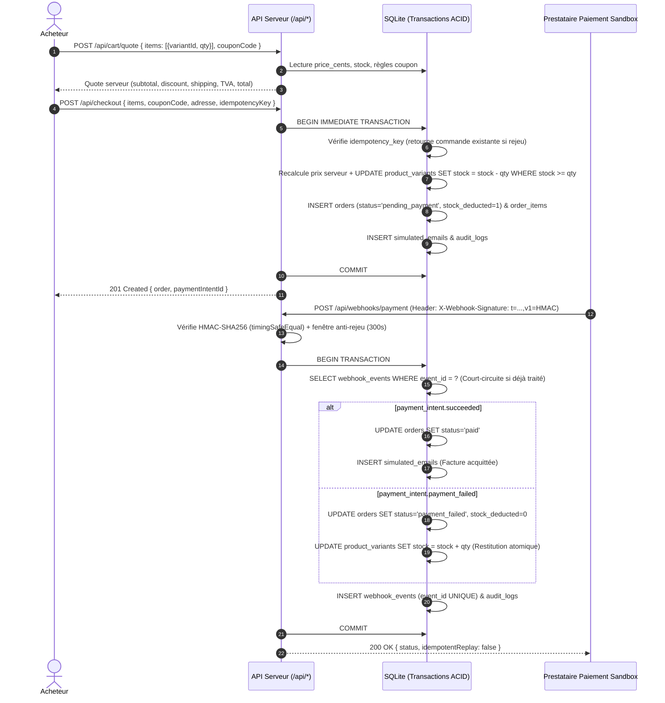

# Architecture Logicielle & Sécurité — Maison Véra E-Commerce

## 1. Reformulation du Besoin, Utilisateurs & Justification de la Stack

### 1.1 Objectif Produit & Persona Utilisateurs
Construire une boutique e-commerce complète, transactionnelle et sécurisée opérant en environnement de paiement test (Sandbox), couvrant l'intégralité de la chaîne de valeur :
- **Visiteur / Acheteur (Guest ou Client connecté)** : parcours du catalogue par catégorie/recherche, sélection des variantes et finitions, vérification des stocks en temps réel, simulation instantanée du panier avec codes promotionnels, passage de commande idempotent, paiement sandbox et réception d'emails transactionnels simulés.
- **Client Authentifié (`role = customer`)** : création de compte, authentification sécurisée, consultation de l'historique de ses commandes et de ses emails transactionnels.
- **Administrateur d'Atelier (`role = admin`)** : gestion des stocks et prix des variantes en temps réel, pilotage des statuts de commandes (avec restitution automatique du stock en cas d'annulation), création/désactivation des coupons, audit des webhooks signés et journal d'audit sécurité.

### 1.2 Justification de l'Architecture Technique
Suite au refus explicite du provisionnement Cloud externe (Cloud SQL / Firebase) dans l'environnement d'exécution, nous avons retenu une architecture **Full-Stack TypeScript monolithique modulaire** reposant sur :
- **Frontend** : React 19 + TypeScript strict + Tailwind CSS v4 (design éditorial *Maison Véra*).
- **Backend API & Domaine** : Node.js + Express 4 + validation stricte **Zod** (`src/server/app.ts`, `src/server/domain.ts`, `src/server/security.ts`).
- **Base de Données Relationnelle Embarquée** : **SQLite (`better-sqlite3`) en mode WAL (`journal_mode = WAL`, `foreign_keys = ON`)**.
  - *Justification* : Contrairement à un stockage en mémoire ou JSON fragile, SQLite en mode WAL offre de véritables **transactions ACID sérialisées** (`db.transaction(...)`), des contraintes d'intégrité référentielle (`FOREIGN KEY`), des contraintes `CHECK (stock >= 0)` et des index `UNIQUE` indispensables pour garantir :
    1. L'absence de survente (*overselling*) lors de la réservation de stock au checkout.
    2. L'idempotence stricte des commandes (`orders.idempotency_key UNIQUE`) et des webhooks de paiement (`webhook_events.event_id UNIQUE`).
    3. L'exécution instantanée de la suite de tests d'intégration (`vitest` + `supertest`) sur base isolée `:memory:`.

---

## 2. Diagramme d'Architecture & Flux Transactionnels (Mermaid)

### 2.1 Architecture Globale des Composants

```mermaid
flowchart TB
  subgraph Client["Frontend React 19 (Port 3000)"]
    UI_Catalog["Catalogue & Fiche Produit (PDP)"]
    UI_Cart["Panier & Checkout (Idempotency Key)"]
    UI_Sandbox["Terminal Paiement Sandbox & Webhooks"]
    UI_Account["Portail Client & Outbox Emails"]
    UI_Admin["Back-Office Admin (Stocks, Commandes, Coupons, Audit)"]
  end

  subgraph Server["Serveur Node.js / Express (src/server/)"]
    MW_Sec["Middlewares : Rate Limit, RawBody Capture, RBAC Auth, Zod"]
    Svc_Domain["EcommerceService (src/server/domain.ts)"]
    Svc_Crypto["Security Module : PBKDF2-SHA512 & HMAC-SHA256"]
  end

  subgraph Storage["Base Relationnelle SQLite WAL (src/server/db.ts)"]
    DB_Catalog[("products & product_variants")]
    DB_Orders[("orders & order_items")]
    DB_Coupons[("coupons")]
    DB_Webhooks[("webhook_events (event_id UNIQUE)")]
    DB_Audit[("simulated_emails & audit_logs")]
  end

  UI_Catalog -->|GET /api/catalog| MW_Sec
  UI_Cart -->|POST /api/cart/quote & /api/checkout| MW_Sec
  UI_Sandbox -->|POST /api/webhooks/payment (X-Webhook-Signature)| MW_Sec
  UI_Account -->|POST /api/auth/* & GET /api/orders/my| MW_Sec
  UI_Admin -->|GET/PATCH/POST /api/admin/* (Bearer Admin)| MW_Sec

  MW_Sec --> Svc_Crypto
  MW_Sec --> Svc_Domain
  Svc_Domain --> DB_Catalog
  Svc_Domain --> DB_Orders
  Svc_Domain --> DB_Coupons
  Svc_Domain --> DB_Webhooks
  Svc_Domain --> DB_Audit
```

### 2.2 Séquence Checkout, Réservation de Stock & Webhook Signé Idempotent



---

## 3. Modèle de Données Relationnel

| Table | Clé Primaire / Contraintes Uniques | Colonnes Clés & Règles d'Intégrité |
| :--- | :--- | :--- |
| `users` | `id` (PK), `email` (`UNIQUE`) | `name`, `password_hash` (PBKDF2-SHA512), `role` (`CHECK IN ('customer', 'admin')`) |
| `sessions` | `token_hash` (PK HMAC-SHA256) | `user_id` (FK `users.id`), `expires_at` |
| `products` | `id` (PK), `slug` (`UNIQUE`) | `title`, `category`, `subtitle`, `description`, `craftsmanship`, `dimensions`, `image_url`, `active` |
| `product_variants` | `id` (PK), `sku` (`UNIQUE`) | `product_id` (FK), `name`, `finish`, `price_cents` (`>= 0`), `stock` (`CHECK (stock >= 0)`) |
| `coupons` | `id` (PK), `code` (`UNIQUE`) | `discount_type` (`percentage` \| `fixed_cents`), `discount_value`, `min_subtotal_cents`, `max_uses`, `used_count`, `active`, `expires_at` |
| `orders` | `id` (PK), `order_number` (`UNIQUE`), `payment_intent_id` (`UNIQUE`), `idempotency_key` (`UNIQUE`) | `user_id`, `customer_email`, `subtotal_cents`, `discount_cents`, `shipping_cents`, `tax_cents`, `total_cents`, `status`, `stock_deducted` (`0` ou `1`) |
| `order_items` | `id` (PK) | `order_id` (FK), `product_id`, `variant_id`, `sku`, `unit_price_cents`, `quantity`, `line_total_cents` |
| `webhook_events` | `id` (PK), `event_id` (`UNIQUE`) | `event_type`, `payment_intent_id`, `order_id`, `signature_valid`, `status`, `payload_json`, `processed_at` |
| `simulated_emails` | `id` (PK) | `order_id`, `recipient_email`, `subject`, `template_name`, `body_text`, `sent_at` |
| `audit_logs` | `id` (PK) | `actor_user_id`, `actor_email`, `action`, `target_type`, `target_id`, `details_json`, `ip_address`, `created_at` |

---

## 4. Contrats d'API & Matrice des Permissions (RBAC)

| Méthode & Route | Permission | Description & Garanties |
| :--- | :--- | :--- |
| `GET /api/catalog` | Public | Liste les produits actifs et leurs variantes (prix unitaire en centimes et stock). |
| `POST /api/cart/quote` | Public | Recalcule côté serveur le panier (`items`, `couponCode`) : sous-total, remise, livraison (offerte dès 500 €), TVA 20%, total TTC. |
| `POST /api/checkout` | Public / Client | Crée une commande dans une transaction ACID avec réservation de stock et clé d'idempotence (`idempotencyKey`). Rate-limited. |
| `POST /api/webhooks/payment` | Prestataire (HMAC) | Réceptionne les webhooks signés via l'en-tête `X-Webhook-Signature: t=...,v1=...`. Idempotent via `event_id`. |
| `POST /api/payments/sandbox-simulate` | Sandbox Test | Génère et expédie un événement webhook signé (ou volontairement altéré) vers le moteur de traitement. |
| `POST /api/auth/register` | Public | Crée un compte `customer`, hache le mot de passe, génère un email de bienvenue simulé. |
| `POST /api/auth/login` | Public | Authentifie un utilisateur et retourne un jeton Bearer dont seul le condensat HMAC est stocké en base. |
| `GET /api/orders/my` | Authentifié (`requireAuth`) | Retourne les commandes et emails simulés appartenant exclusivement à l'utilisateur connecté. |
| `GET /api/orders/:id` | Propriétaire / Admin / Token PI | Retourne le détail d'une commande et ses emails associés. |
| `GET /api/admin/overview` | Admin (`requireAdmin`) | Retourne stocks, commandes globales, coupons, webhooks, emails simulés et `audit_logs`. |
| `PATCH /api/admin/variants/:id` | Admin (`requireAdmin`) | Met à jour le stock et le prix d'une variante avec journalisation d'audit. |
| `PATCH /api/admin/orders/:id/status` | Admin (`requireAdmin`) | Change le statut d'une commande et restitue/réserve automatiquement le stock selon la transition. |
| `POST /api/admin/coupons` | Admin (`requireAdmin`) | Crée un nouveau code promotionnel validé par schéma Zod. |
| `PATCH /api/admin/coupons/:id` | Admin (`requireAdmin`) | Active ou désactive un code promotionnel. |

---

## 5. Analyse des Risques (Sécurité, Confidentialité, Coûts & Dépendances)

1. **Manipulation des prix ou remises côté client** :
   - *Mitigation* : `calculateCartPricing` n'accepte que `{ variantId, quantity }` et `couponCode`. Tout champ `priceCents` injecté dans le JSON client est ignoré par Zod et recalculé depuis `product_variants`.
2. **Falsification ou rejeu de Webhooks de paiement** :
   - *Mitigation* : Vérification HMAC-SHA256 sur le corps brut (`req.rawBody`) via `crypto.timingSafeEqual`, fenêtre d'horodatage de 300 secondes et contrainte `UNIQUE` sur `webhook_events.event_id`.
3. **Concurrence et survente de stock (*Race Conditions*)** :
   - *Mitigation* : Décrémentation conditionnelle `UPDATE product_variants SET stock = stock - ? WHERE id = ? AND stock >= ?` exécutée au sein d'une transaction SQLite atomique. Si `res.changes !== 1`, la transaction entière est annulée (`ROLLBACK`).
4. **Protection des secrets et données personnelles (RGPD)** :
   - *Mitigation* : Aucun secret réel dans le dépôt (`.env.example` documenté). Mots de passe salés et hachés avec PBKDF2-SHA512 (100 000 itérations). Jetons de session hachés en base. Données pré-remplies 100% synthétiques (`.test`).
