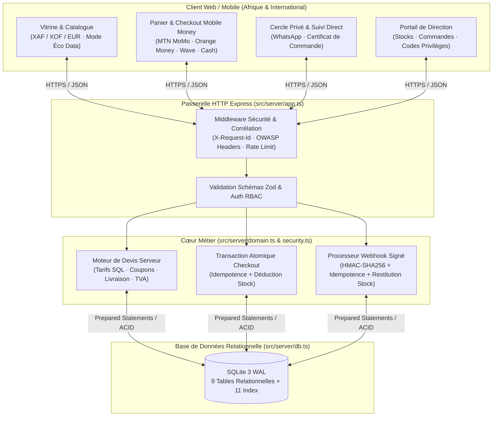
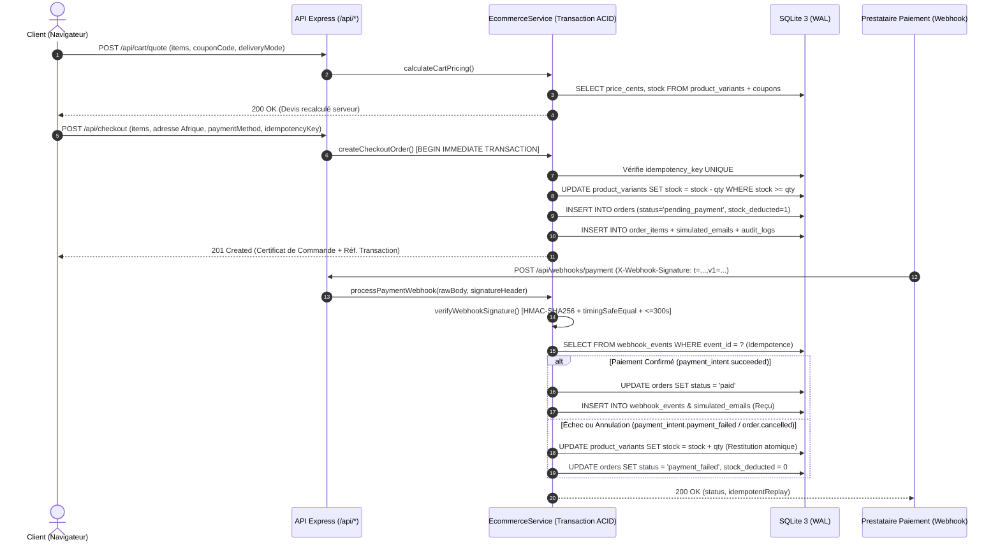

# Dossier d'Architecture Logicielle — Maison Véra E-Commerce (Normes Internationales)

Ce document décrit l'architecture complète, les choix d'ingénierie, la modélisation des données, les flux transactionnels, la matrice de sécurité (OWASP ASVS) et l'observabilité de la plateforme **Maison Véra — Haute Facture Architecturale (Édition Afrique & International)**.

---

## 1. Principes Architecturaux Directeurs (ISO/IEC 25010 & Clean Architecture)

L'application est structurée selon une **architecture modulaire en couches strictement découplées** :

1. **Couche Présentation (`src/App.tsx`, `src/components/*`, `src/utils/format.ts`)**
   - Responsabilité unique : Expérience utilisateur éditoriale de luxe (*Warm Minimalist Luxury*), gestion du panier réactif, conversion multi-devises d'affichage (`XAF`, `XOF`, `EUR`), mode Éco Data (3G/4G) et parcours d'achat fluide sans aucune exposition de détails d'implémentation serveur.
2. **Couche Transport & Sécurité HTTP (`src/server/app.ts`)**
   - Responsabilité unique : En-têtes de sécurité HTTP, corrélation des requêtes (`X-Request-Id`), limitation de débit mémoire-sûre (`Rate Limiter` avec `Retry-After`), validation stricte des schémas d'entrée (**Zod**), authentification par jeton Bearer, contrôle d'accès basé sur les rôles (`requireAuth`, `requireAdmin`) et sérialisation normalisée des erreurs.
3. **Couche Domaine Métier & Transactions (`src/server/domain.ts`)**
   - Responsabilité unique : Autorité serveur sur les prix (`calculateCartPricing`), réservation atomique et restitution des stocks (`createCheckoutOrder`, `processPaymentWebhook`), idempotence des paiements et génération des notifications transactionnelles (courriels et résumés SMS/WhatsApp).
4. **Couche Cryptographie (`src/server/security.ts`)**
   - Responsabilité unique : Hachage des mots de passe (`PBKDF2-SHA512`, 100 000 itérations), hachage des sessions (`HMAC-SHA256`), et signature/vérification des webhooks en temps constant (`crypto.timingSafeEqual`) avec fenêtre anti-rejeu de 300 secondes.
5. **Couche Persistance Relationnelle ACID (`src/server/db.ts`)**
   - Responsabilité unique : Gestion de la base relationnelle **SQLite 3 en mode WAL (`Write-Ahead Logging`)**, intégrité référentielle (`PRAGMA foreign_keys = ON`), indexation secondaire haute performance et migrations idempotentes.

---

## 2. Diagramme d'Architecture & Flux Transactionnels (Mermaid)

### 2.1 Vue des Composants (C4 Container View)

### 2.2 Séquence Critique : Checkout Atomique & Webhook de Paiement Idempotent

---

## 3. Schéma de Données Relationnel & Stratégie d'Indexation

### 3.1 Tables Principales (9 Tables)
1. **`users`** : Comptes clients et administrateurs (`id`, `email UNIQUE`, `name`, `password_hash`, `role CHECK('customer','admin')`).
2. **`sessions`** : Sessions actives (`token_hash PRIMARY KEY`, `user_id FK`, `expires_at`).
3. **`products`** : Catalogue des pièces architecturales (`id`, `slug UNIQUE`, `title`, `category`, `craftsmanship`, `dimensions`, `image_url`, `active`).
4. **`product_variants`** : Variantes et stocks (`id`, `product_id FK`, `sku UNIQUE`, `name`, `finish`, `price_cents CHECK(>=0)`, `stock CHECK(>=0)`).
5. **`coupons`** : Codes privilèges (`id`, `code UNIQUE`, `discount_type`, `discount_value`, `min_subtotal_cents`, `max_uses`, `used_count`, `active`, `expires_at`).
6. **`orders`** : Commandes avec coordonnées complètes (`id`, `order_number UNIQUE`, `user_id FK`, `customer_email`, `customer_phone`, `shipping_address`, `shipping_city`, `shipping_country`, `landmark`, `delivery_mode`, `payment_method`, `subtotal_cents`, `discount_cents`, `shipping_cents`, `tax_cents`, `total_cents`, `status`, `payment_intent_id UNIQUE`, `idempotency_key UNIQUE`, `stock_deducted`).
7. **`order_items`** : Lignes de commande figées au tarif du jour (`order_id FK`, `variant_id FK`, `sku`, `unit_price_cents`, `quantity`, `line_total_cents`).
8. **`webhook_events`** : Registre d'idempotence des webhooks (`event_id UNIQUE`, `event_type`, `payment_intent_id`, `order_id FK`, `signature_valid`, `status`, `payload_json`).
9. **`simulated_emails` & `audit_logs`** : Traçabilité des courriers envoyés aux clients et journal d'audit sécurité immuable.

### 3.2 Index Secondaires Déployés (Zéro Full-Table Scan)
- `idx_sessions_user_id` & `idx_sessions_expires_at` : Validation et purge rapide des sessions.
- `idx_variants_product_id` : Chargement instantané des variantes du catalogue.
- `idx_orders_user_id`, `idx_orders_customer_email`, `idx_orders_status` : Recherche client et filtrage direction.
- `idx_order_items_order_id` : Chargement groupé (*Batch Loading* sans requête $N+1$) des lignes de commandes.
- `idx_webhook_events_order_id`, `idx_simulated_emails_recipient`, `idx_simulated_emails_order_id`, `idx_audit_logs_created_at`.

---

## 4. Contrats d'API REST & Modèle de Permissions (RBAC)

| Méthode & Route | Accès / Rôle | Description & Garanties |
| :--- | :--- | :--- |
| `GET /api/health` | Public (Sonde) | Vérifie la connexion SQLite et retourne l'état de santé (`status: 'ok'`). |
| `GET /api/catalog` | Public | Liste les pièces actives et leurs variantes avec stock temps réel. |
| `POST /api/cart/quote` | Public | Recalcule intégralement le panier côté serveur (sous-total, code privilège, livraison, TVA). |
| `POST /api/checkout` | Public / Client | Crée une commande de manière transactionnelle et idempotente avec réservation atomique du stock. |
| `GET /api/orders/track` | Public (Vérifié) | Suivi direct par `orderNumber` + vérification de correspondance `contact` (téléphone ou email). |
| `GET /api/orders/:id` | Propriétaire / Admin | Détail d'une commande et de ses courriers (protégé par propriété ou jeton de transaction). |
| `POST /api/webhooks/payment` | Passerelle (HMAC) | Réception de webhook signé `X-Webhook-Signature` (`HMAC-SHA256`) et idempotent. |
| `POST /api/auth/register` | Public (Rate-Limited) | Création d'un compte client (`PBKDF2-SHA512`) et ouverture de session. |
| `POST /api/auth/login` | Public (Rate-Limited) | Authentification et émission d'un jeton Bearer. |
| `GET /api/orders/my` | Client (`requireAuth`) | Historique des commandes et courriers du membre connecté. |
| `GET /api/admin/overview` | Admin (`requireAdmin`) | Vue consolidée de direction (stocks, commandes, codes privilèges, audit). |
| `PATCH /api/admin/variants/:id` | Admin (`requireAdmin`) | Ajustement du stock et du prix d'une variante avec traçabilité dans `audit_logs`. |
| `PATCH /api/admin/orders/:id/status` | Admin (`requireAdmin`) | Changement de statut d'une commande avec restitution/réservation automatique du stock. |
| `POST /api/admin/coupons` | Admin (`requireAdmin`) | Création d'un nouveau code privilège. |

---

## 5. Matrice de Sécurité & Conformité Internationale (OWASP ASVS)

1. **Intégrité Financière** : Aucun prix ni taux de remise n'est accepté depuis le client. Toute divergence est ignorée et recalculée par `EcommerceService.calculateCartPricing`.
2. **Protection contre les Conditions de Course (Race Conditions)** : L'instruction SQL `UPDATE product_variants SET stock = stock - ? WHERE id = ? AND stock >= ?` exécutée dans une transaction SQLite sérialisée garantit qu'un stock ne peut jamais devenir négatif, même sous forte concurrence.
3. **Protection contre la Falsification et le Rejeu de Webhooks** :
   - Signature `HMAC-SHA256` sur `${timestamp}.${rawBody}`.
   - Comparaison en temps constant (`crypto.timingSafeEqual`).
   - Rejet automatique si `|now - timestamp| > 300s`.
   - Unicité stricte sur `webhook_events.event_id`.
4. **Traçabilité & Diagnostic (`X-Request-Id`)** : Chaque réponse HTTP et chaque message d'erreur JSON comporte un identifiant unique `X-Request-Id` facilitant l'audit et le support.
